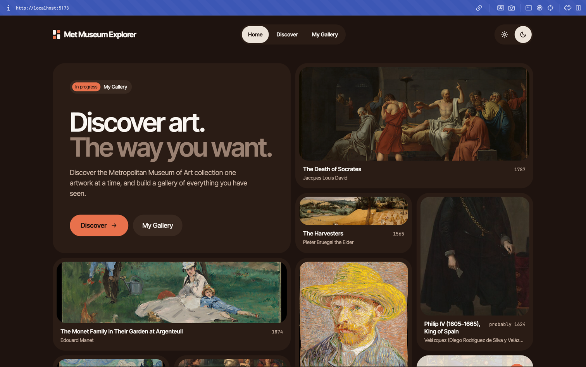
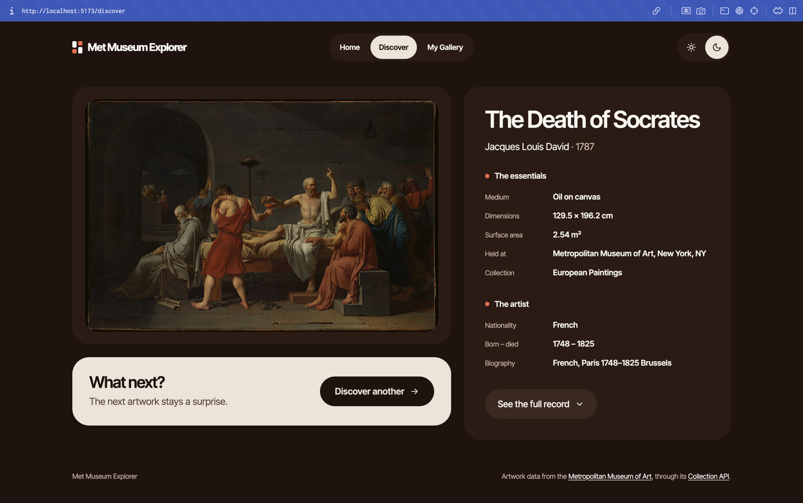
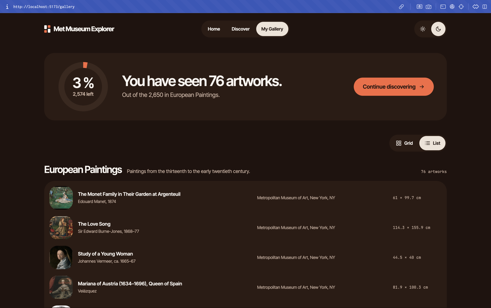

# Met Museum Explorer

A React single-page application built on the public
[Metropolitan Museum of Art collection API](https://metmuseum.github.io/).

## Overview

Met Museum Explorer turns the Metropolitan Museum of Art's open collection API
into a game of discovery. Instead of a search box, the visitor is shown **one
artwork at a time, drawn at random**, with the museum's own record beside it.
Every artwork seen is kept in **My Gallery**, which shows them all in a grid or
a list and measures how much of the collection the visitor has been through.

The data is one department of the museum: **European Paintings**, department
11, whose 2,650 records are the whole the application draws from and counts
against. The museum lists 503,459 objects in all; the application deliberately
exploits one slice of the API thoroughly rather than every endpoint shallowly.

Why these choices:

- **One department, European Paintings.** A screen built around one large
  picture needs works that are photographed, dated and measured. This
  department is almost entirely paintings, and its identifier list is small
  enough to read in a single call.
- **A random draw rather than a search.** Discovery is the point: the
  visitor meets works they would never have typed the name of. The draw never
  shows the same work twice, across visits.
- **A gallery that remembers.** There is no backend, so what a visitor has
  seen is kept in the browser; it is what makes the draw non-repeating and the
  progress figure meaningful.

## Features

| Feature | Where | Minimum it covers |
| --- | --- | --- |
| Discover: one random artwork at a time, with its full record | `/discover` | — |
| Artwork record at its own address, with an invalid address handled | `/discover/<id>` | **Detail view** |
| My Gallery: every artwork seen, in a grid or a list | `/gallery` | **List** |
| Completion ring: share of the collection seen | `/gallery` | **Chart** |
| More about my gallery: centuries and mediums of the artworks seen | `/gallery` | Further charts |
| Home page, not-found page, day and night modes | `/`, any unknown address | Navigation |

The three screenshots below were taken in the night mode, Cocoa, on a desktop
browser 1,512 px wide.

### Home — `/`



**What the screenshot shows**

- **The bar.** It carries the logotype, which leads home, then the three
  destinations, with **Home** marked as the current one. On the right is the
  day and night switch, with the crescent pressed.
- **The headline block.** "Discover art. The way you want." with one line on
  what the application does, the primary **Discover** button and the secondary
  **My Gallery** button.
- **The bento grid.** It holds seven artworks of European Paintings: David's
  *The Death of Socrates*, Bruegel's *The Harvesters*, Velázquez's *Philip IV*,
  Manet's *The Monet Family in Their Garden at Argenteuil*, Van Gogh's
  *Self-Portrait with a Straw Hat*, and two more below the fold.
  - Each tile's size follows the shape of the painting it holds: wide,
    portrait, panoramic or small.
  - Each caption gives the title, the artist and the year. The year is in the
    monospace face, because it is a figure.

**Features**

- **A fixed selection.** The selection never changes and costs no call to the
  museum. Every title, artist, date and picture is the API's own value for a
  real object.
- **Every tile opens that artwork** with its full record on Discover, at
  `/discover/<id>`.
- **Long captions stay inside their box.** A long title is held to two lines,
  and a long artist name, like Velázquez's, is cut with an ellipsis, so every
  caption keeps the same height.
- **The pictures load lazily, the textures are veiled.** Pictures load as
  they scroll into view. The two textures behind the inverted blocks are
  decorative, veiled so that their text keeps its contrast.

### Discover — `/discover` and `/discover/<id>`



**What the screenshot shows**

- **The bar** with **Discover** marked as the current destination.
- **On the left, the picture.** *The Death of Socrates* is framed at the
  painting's real proportions (129.5 × 196.2 cm).
- **Under the picture, the "What next?" band.** It holds the
  **Discover another** button.
- **On the right, the wall label.**
  - The title, at the largest of its four sizes, since it is short.
  - "Jacques Louis David · 1787".
  - **The essentials**: medium, dimensions, the surface area computed from
    them (2.54 m²), where the painting is kept, and the collection.
  - **The artist**: nationality, life dates and biography.
  - **See the full record**, which unfolds the rest.
- **The footer** credits the museum and its Collection API.

**Features**

- **A draw on arrival, with the next artwork ready behind it.** An artwork is
  drawn at random the moment the screen opens. A second one is drawn behind
  it, its picture preloaded, so **Discover another** shows the next work
  without waiting for the museum. A work is never drawn twice, even across
  visits.
- **A moment to look.** The button is held shut for three seconds after an
  artwork appears, and the band says how long is left.
- **A record that scales.** The title takes one of four sizes depending on its
  length, so a two-word title and a paragraph-long one both fit the column.
  Empty fields are left out rather than shown as orphan labels.
- **The full record behind one click.** The folded record holds the object's
  details, the credit line, the image rights ("Public domain", or the
  museum's credit when the work is not) and the link to the artwork's page on
  metmuseum.org, which says it opens a new tab.
- **The same artwork when you come back.** Leaving for another screen and
  coming back finds the same artwork: the run lives above the router.
- **Every artwork at its own address.** `/discover/<id>` opens any artwork of
  the collection with this same screen, from My Gallery, from the home page or
  from a shared link.
  - An address that is not a number, an artwork the department does not hold,
    or one the museum serves no picture for gets a clear message, **Try
    again**, and a way back.
  - It is never a blank page.

### My Gallery — `/gallery`



**What the screenshot shows**

- **The progress card.**
  - On the left, the completion ring: **3 %** of the collection seen, with
    **2,574 left** under it.
  - The headline "You have seen 76 artworks." and its sample, "Out of the
    2,650 in European Paintings."
  - On the right, **Continue discovering**.
- **The layout switch**, set to **List**.
- **The collection heading.** "European Paintings", one line on what it holds,
  and the count, "76 artworks".
- **The list.** Its rows go from the most recently seen down: Manet's *The
  Monet Family*, Burne-Jones's *The Love Song*, Vermeer's *Study of a Young
  Woman*, Velázquez's *Mariana of Austria*.
  - Each row gives a thumbnail, the title, the artist and date, where the work
    is kept, and its size in centimetres.

**Features**

- **Every artwork Discover reveals is kept.** It stays in the browser, on this
  visit and the next ones, so the gallery opens without a single call to the
  museum.
- **The completion ring** is the chart of the application. It uses the
  shadcn/ui donut-with-text, the share is written in its middle, and the sample
  is stated beside it. The total is the very list Discover draws from, so "the
  possible artworks" means the same thing on both screens.
- **More about my gallery.** A folded section under the progress card unfolds
  two bar charts, in numbers of works:
  - **By century**: the artworks seen, by the century they were painted in.
    Each bar's tooltip adds how many works the collection holds from that
    century, counted with one `v1.1/search` query per century.
  - **By medium**: a pie of what the artworks seen are made of, the four most
    frequent mediums and the rest, each named and counted in the legend.

  The eight counts take a few seconds at the museum, so they are requested as
  soon as My Gallery opens and are ready when the section unfolds; they are
  then kept in the browser for a day, and the chart appears at once.
- **Grid or list, and the choice is remembered.** The grid shows each picture
  at its real proportions. The list adds where each work is kept. A pointer
  over a row highlights it.
- **Pictures load only as they come into view.** A gallery of hundreds of works
  never downloads them all. Until a card comes within about one row of the
  screen, its frame is drawn empty at its final size, so nothing moves when the
  picture arrives.
- **Every card and every row opens the artwork on Discover**, at
  `/discover/<id>`.
- **A first visit is invited to start.** A visitor who has seen nothing yet is
  invited to start, and the ring shows the size of the collection at once,
  from the last count kept in the browser.

### Everywhere

- **Day and night modes, Sand and Cocoa.** Each is one palette with its roles
  swapped. The mode chosen is pinned before the first paint, so it never
  flashes.
- **Visible states.** Loading, error and empty states are always shown, with a
  retry where one makes sense.
- **Navigation.** The bar marks the current screen, and an unknown address
  gets a not-found page that leads home.
- **Layout and accessibility.** One breakpoint, at 761 px, for phones.
  Keyboard focus is visible, controls are at least 44 px, and every picture's text
  alternative is built from its artist, title and date.

## Quick start

Clone the repository and move into it:

```bash
git clone https://github.com/RaavenBZH/museum-challenge.git
cd museum-challenge
```

### With Docker

The only requirement is Docker with the Compose plugin. One command starts the
development server:

```bash
docker compose up
```

Then open <http://localhost:5173>. Edits to the sources are picked up live
through hot module replacement.

If another project on your machine already holds port 5173 or 8080, copy
`.env.example` to `.env` and change `MUSEUM_WEB_PORT` or
`MUSEUM_PRODUCTION_PORT`.

Two further services are available behind Compose profiles:

```bash
docker compose run --rm checks                         # lint, type-check and test in a container
docker compose --profile production up production      # production build served by nginx
```

The production image builds the application and serves `dist/` with nginx on
<http://localhost:8080>, falling back to `index.html` so that any client-side
route can be opened directly. Naming the `production` service matters:
`docker compose --profile production up` alone would also start the
development server, which has no profile.

Compose mounts only the source directories, not the whole tree, so the
`node_modules` installed inside the image is never shadowed by a volume that
could hold stale packages. After changing a dependency in `package.json`, rebuild
so that the install runs again:

```bash
docker compose up --build
```

### Without Docker

Requirements:

| Tool | Version | Notes |
| --- | --- | --- |
| Node.js | 24.22.1 | pinned in `.nvmrc`; run `nvm use` to select it |
| pnpm | 10.15.1 | pinned in `package.json` via `packageManager`; `corepack enable pnpm` provides it |

TypeScript is pinned to 6.0.3 rather than 7, because `typescript-eslint` 8 still
declares `typescript <6.1.0` as a peer dependency and a newer compiler would make
`pnpm install` report an unmet peer.

```bash
nvm use                 # selects the Node version from .nvmrc
corepack enable pnpm    # once per Node installation
pnpm install            # install dependencies from pnpm-lock.yaml
pnpm dev                # start the development server
```

The development server prints its address; by default it is
<http://localhost:5173>.

Other commands:

```bash
pnpm build       # type-check the project, then build for production into dist/
pnpm preview     # serve the production build locally
pnpm lint        # run ESLint over the whole project
pnpm typecheck   # run the TypeScript compiler without emitting output
pnpm test        # run the unit and component tests once
pnpm test:watch  # run the tests in watch mode while developing
pnpm test:e2e    # build, serve and run the end-to-end journeys in Chromium
```

The end-to-end tests need Playwright's Chromium, downloaded once (about
100 MB):

```bash
pnpm exec playwright install chromium
```

## Architecture

```text
.
├── index.html                        # entry document, mounts the app in #root and pins the saved mode
├── Dockerfile                        # multi-stage: development, checks, build, production
├── compose.yaml                      # services: web (default), checks, production
├── .env.example                      # overridable host ports for Compose
├── docker
│   └── nginx.conf                    # static server with client-side route fallback
├── components.json                   # shadcn/ui registry configuration
├── docs
│   ├── DESIGN_SYSTEM.md              # the Sand / Cocoa design system reference
│   ├── home.png                      # screenshot of the home page, in the Features section
│   ├── discover.png                  # screenshot of Discover
│   └── gallery.png                   # screenshot of My Gallery
├── public
│   └── favicon.svg                   # the logotype mark, following the browser's colour scheme
├── e2e
│   ├── discovery.spec.ts             # the journeys, in a real browser
│   ├── collectionApiMock.ts          # answers every call to the museum from the fixtures
│   └── fixtures                      # API responses recorded from the real museum, and a picture
├── playwright.config.ts              # builds and serves the app, then runs the journeys in Chromium
├── vite.config.ts                    # Vite plugins (React, Tailwind), @ alias and Vitest setup
├── eslint.config.js                  # ESLint flat config, React Hooks rules enabled
├── tsconfig.json                     # project references and the @ path alias
├── tsconfig.app.json                 # TypeScript options for the application sources
├── tsconfig.node.json                # TypeScript options for the build tooling
└── src
    ├── main.tsx                      # React entry point: providers, router, <App />
    ├── App.tsx                       # page shell and routes
    ├── index.css                     # stylesheet entry point: Tailwind, fonts, tokens
    ├── styles
    │   ├── design-tokens.css         # colour, type, spacing, radii tokens and the two modes
    │   └── shadcn-tokens.css         # maps shadcn/ui variable names onto those tokens
    ├── api                           # the only layer that calls fetch
    │   ├── metMuseumEndpoints.ts     # every URL of the collection API
    │   ├── metMuseumErrors.ts        # one error type per way a call can fail
    │   ├── requestQueue.ts           # spaces the calls, to stay under the IP block
    │   ├── responseCache.ts          # one answer per URL, with in-flight sharing
    │   ├── metMuseumClient.ts        # GET as JSON: status, queue, cache, abort
    │   ├── metMuseumObjects.ts       # the two object endpoints, read through the client
    │   └── metMuseumSearch.ts        # v1.1/search, read for how many works a period holds
    ├── domain                        # pure model: no React, no fetch
    │   ├── artwork.ts                # type Artwork and the mapper from the payload
    │   ├── artworkFacts.ts           # the rows and blocks of the record
    │   ├── artworkTitleScale.ts      # which step a title is set at, by its length
    │   ├── artworkDraw.ts            # drawing one identifier at random
    │   ├── collectionError.ts        # what to tell a visitor about a refusal
    │   ├── discoveryCollection.ts    # department 11, the collection Discover draws from
    │   ├── discoveryProgress.ts      # how much of it has been seen, and its figures
    │   ├── discoveryRoute.ts         # /discover/<id>, the address an artwork opens at
    │   ├── galleryLayout.ts          # grid or list, the two layouts of My Gallery
    │   ├── galleryInsights.ts        # centuries and mediums of the artworks seen
    │   ├── seenArtwork.ts            # what My Gallery keeps of an artwork once seen
    │   └── themeModes.ts             # the Sand / Cocoa modes and their storage key
    ├── hooks                         # React state, held above the router
    │   ├── DiscoveryProvider.tsx     # the discovery run: one shown, one held ahead
    │   ├── DiscoveryContext.ts       # the shape of that run
    │   ├── useDiscovery.ts           # reads the run
    │   ├── drawRandomArtwork.ts      # one draw, skipping the objects with no picture
    │   ├── fetchDiscoveryArtwork.ts  # one named artwork of the collection, opened on Discover
    │   ├── useArtworkContemplation.ts # the three seconds an artwork is given
    │   ├── browserStorage.ts         # the one guarded read and write of localStorage
    │   ├── seenArtworksStorage.ts    # keeps the artworks seen in the browser
    │   ├── useGalleryLayout.ts       # the layout last chosen, kept in the browser
    │   ├── useDiscoveryCollectionSize.ts # how many artworks Discover can draw from
    │   ├── useCollectionCenturies.ts # the collection counted by century, on demand
    │   ├── ThemeProvider.tsx         # resolves the mode, writes data-theme, persists it
    │   ├── ThemeContext.ts           # React context holding the current mode
    │   └── useTheme.ts               # reads the mode
    ├── pages                         # one screen per route
    │   ├── HomePage.tsx              # the bento landing page
    │   ├── DiscoverPage.tsx          # one artwork at a time, with its record; /discover/<id> too
    │   ├── GalleryPage.tsx           # My Gallery: progress ring, then every artwork seen
    │   ├── NotFoundPage.tsx          # unknown address, with the way home
    │   ├── homeFeaturedArtworks.ts   # the seven European Paintings of the home page
    │   └── homeTextures.ts           # the two veiled pictures behind the inverted blocks
    ├── components                    # presentation only: props in, nothing else
    │   ├── brand                     # the logotype, and the logotype as a link home
    │   ├── layout                    # header, navigation, footer, bento, notice, boundary
    │   ├── theme                     # the day / night switch
    │   ├── landing                   # headline block, action tile, closing banner
    │   ├── artwork                   # artwork card and artwork image
    │   ├── discover                  # stage, wall label, fact section, next-artwork band
    │   ├── statistics                # the completion ring, centuries and mediums charts
    │   ├── gallery                   # layout switch, grid, list, lazy pictures, links, More about my gallery
    │   ├── icons                     # the seven icons of the system
    │   └── ui                        # button, badge, artwork year, shadcn/ui chart
    ├── lib
    │   ├── utils.ts                  # cn(): merges class names, knowing the system's type scale
    │   └── isRecord.ts               # the first check of anything read from outside
    └── test
        ├── artworkFixture.ts         # the artwork the tests are written against
        ├── intersectionObserverStub.ts # brings an element into view by hand
        └── setupTestingLibrary.ts    # jest-dom matchers, DOM cleanup, matchMedia stub
```

Modules are imported through the `@` alias, which points at `src`: `@/lib/utils`
rather than a chain of relative segments. It is declared once in
`tsconfig.json` and once in `vite.config.ts`, so the compiler, the bundler and
the test runner all resolve it.

The layers only ever depend downwards: `pages/` reads `hooks/`, `hooks/` read
`api/` and `domain/`, and `domain/` is pure — no React, no `fetch`, only the
types of `api/`. `components/` sits beside that chain rather than in it: a
component never reads a context and never calls the museum. It may use a pure
function of `domain/`, such as the wording of a missing artist or the address
of an artwork, and two of them keep state that belongs to the screen alone — a
folded record, a picture not yet near the viewport. The display mode is read
in `App.tsx` and handed down as props.

How the data travels, for one artwork on Discover:

1. `DiscoveryProvider` (`hooks/`) asks `drawRandomArtwork` for an artwork.
2. `fetchObjectIds` and `fetchObject` (`api/`) build the URLs, and
   `metMuseumClient` serves them from the response cache or sends them through
   the request queue, checking the status before reading the body.
3. `toArtwork` (`domain/`) turns the payload into the model, deciding what
   every empty or misleading field means.
4. The provider puts the artwork on screen, keeps the fields My Gallery shows
   in the browser, and `DiscoverPage` hands the model to the presentation
   components, which draw it.

### AI-assisted Design system

The interface follows the **Sand / Cocoa** design system, described in
[`docs/DESIGN_SYSTEM.md`](docs/DESIGN_SYSTEM.md): a warm, gallery-wall palette
where the artworks are the only source of vivid colour, a single terracotta
accent for the main action, and two modes that are one palette with its roles
swapped rather than two separate themes. The tokens are the only way a component
reaches a colour, a type style or a radius.

### Technical choices

- **Vite** as the build tool, with **pnpm** as the package manager. Vite provides
  the transpiler, bundler and hot-reloading development server the project needs;
  `create-react-app`, the usual alternative, is no longer maintained.
- **TypeScript** rather than plain JavaScript. The API returns objects with many
  optional fields, and static types force every absent value to be handled at the
  call site. TypeScript is pinned to 6.0.3, the latest release supported by
  `typescript-eslint`.
- **Tailwind CSS** through the official Vite plugin, with **shadcn/ui** for the
  charts. shadcn/ui is not a runtime dependency: its CLI copies a component's
  source into the repository, where it is edited like any other file. One
  component came from it, the chart primitives in `src/components/ui/chart.tsx`,
  trimmed to what the charts use and brought into the design system. The
  button, the badge and the other interface components are written by hand
  against the design system's tokens. `src/styles/shadcn-tokens.css` maps
  shadcn/ui's variable names onto those tokens, so anything copied in lands
  inside the palette in both modes. Structural containers carry an explicit
  semantic class name beside the utility classes, so that the rendered DOM
  stays readable.
- **`cn`** to merge class names, configured with the design system's type
  scale so that a `text-caption-meta` and a `text-text-muted` on one element
  are not mistaken for two colours, one of which would be dropped.
- **Charts** are drawn with Recharts inside the shadcn/ui chart primitives,
  their marks filled with design system tokens, so a chart follows the current
  mode and introduces no colour of its own. Recharts is
  the heaviest dependency in the project — measured at 104 kB gzipped against the
  108 kB of everything else — so the screen that draws the chart is loaded with
  `React.lazy`: the first screen never waits for it, and the shell fetches it in
  the background once that screen is idle, so opening My Gallery does not wait
  for it either. The last known size of the collection is kept in the browser,
  so the gallery's ring is drawn on arrival rather than after the two seconds
  the museum takes to send the identifier list.
- **ESLint** with `eslint-plugin-react-hooks`: `rules-of-hooks` is an error and
  `exhaustive-deps` is a warning, which catches effects with incomplete
  dependency arrays.
- **Vitest** with **React Testing Library** in a jsdom environment, so that
  components are queried the way a user would read them.
- **Docker** with a multi-stage image. The `development` stage runs the Vite dev
  server and relies on the sources being bind-mounted by Compose, so it carries
  no copy of them; `checks` runs the linter, the compiler and the tests;
  `production` builds the application and hands `dist/` to nginx. Dependencies
  are installed in their own layer, so editing a source file does not invalidate
  the install cache. Inside a container the file watcher polls, because
  bind-mounted files do not emit reliable filesystem events on macOS or Windows.
  Compose mounts the source directories individually rather than the project
  root: a named volume for `node_modules` would keep packages that have since
  been removed from `package.json`, because Docker only seeds such a volume
  while it is empty.

## Challenges

### The museum blocks a client that asks too often — and sometimes just stops answering

The API documents 80 requests per second. The real behaviour is harsher, and
it was measured rather than taken from the documentation: the probes below were
AI-assisted — Claude Code ran them from a terminal, with `curl` and short
scripts against the live API — and I reviewed the results before the design was
changed to answer them.

- **The IP block.** On 2026-11-09, a survey of field fill rates read 12 to 50
  objects in each of six departments, one request after the other. After about
  140 requests in a few minutes, every endpoint answered 403, `v1/departments`
  included, and the block lifted by itself after roughly five minutes. Running
  the same survey again with the calls spaced 0.4 seconds apart never
  triggered it.
- **The hanging requests.** On 2026-11-19, after some forty further object
  reads made for other measurements, Discover stayed on "Opening the
  artwork…". Single reads timed with `curl` and a 30-second limit showed why:
  three object reads out of four were still unanswered after 30 seconds and the
  fourth took 13.5, while the department's identifier list answered in 2.2. The
  museum's throttling does not always refuse; it can simply stop answering, and
  a screen waiting on such a call would say "loading" forever.

How it was solved, in `src/api/`:

- **Spaced calls.** Every call goes through one queue that spaces their
  *starts* 400 ms apart. It does not wait for a call to finish before starting
  the next. A first version did, and one hanging request then held every call
  behind it: the next draw, the artwork a visitor asked to open.
- **A deadline.** Every call is given up after 20 seconds, response body
  included. It is reported as "the museum is not answering", with a retry.
- **A response cache keyed by URL.** It answers the identifier list from
  memory for an hour, an object for six hours, and holds at most 500 entries.
  Two simultaneous calls for one URL share a single request.
- **Abandoned calls cost nothing.** A screen that goes away abandons its wait.
  The request itself is dropped once *every* caller waiting on it has left,
  and a request dropped before its turn in the queue is never sent.
- **No call for an identifier that cannot exist.** An identifier is checked
  against the cached list of the department before `GET /objects/{id}` is
  addressed, so a bad address fails without spending a call.

### About one artwork in seven comes back without a picture

Fifteen percent of a random sample of department 11 came back with an empty
`primaryImage` and `primaryImageSmall`. The cause, measured on 30 works: the
museum photographs the works still under copyright but withholds their pictures
from the API. Every work of the sample that had a picture was in the public
domain, and the two without one were not.

The other two filters that could have helped do not work:

- **`isPublicDomain` is ignored.** The search endpoint accepts the filter and
  returns the same results without it.
- **The object payload's own `isOnView` flag is wrong.** It is false for
  objects that hang in a gallery, so the gallery number is the one signal the
  model keeps.

How it was solved: the draw reads the object and, if it has no picture, draws
again, up to five times. Reading it is the only reliable test. A rejected work
is in the response cache, so meeting it again costs nothing, and the draw
happens while the visitor is still reading the artwork on screen, so it is
invisible.

### Pictures are heavy, and a gallery can hold hundreds of them

- **The smaller of the two picture files.** The application shows
  `primaryImageSmall` and not `primaryImage`: on object 437937 the first is
  142 kB and the second 2.93 MB, twenty-one times heavier for a frame no taller
  than 620 px.
- **The next picture is already on its way.** On Discover, the artwork's own
  picture is requested first and eagerly (`fetchpriority="high"`). The picture
  of the artwork held behind it is preloaded while the first one is being
  read, so "Discover another" shows an artwork whose picture is already there.
- **The gallery only fetches what is near the screen.** Each picture is
  requested only once its card comes within about one row of the viewport, an
  `IntersectionObserver` with a 240 px margin, with the browser's own lazy
  loading on top. Until then its frame is drawn empty at its final size, so
  nothing moves when the picture arrives.
- **The gallery itself costs no call.** It keeps the nine fields its cards and
  charts use, not the museum's thirty-field records. Every artwork ever seen fits in
  the browser's storage, and the gallery opens without asking the museum
  anything.

### The rest of the loading path

- **Lazy chart.** Recharts (100 kB gzipped) loads with the gallery through
  `React.lazy`, prefetched in the background once the first screen is idle.
- **Early connections.** `index.html` preconnects to the API and the image
  server.
- **Browser storage.** The artworks seen, the collection size and its counts
  by century, the gallery layout and the colour mode are kept in
  `localStorage`, so the gallery, its ring and its charts appear at once. A blocked storage only loses the convenience.
- **No call at start-up.** The first draw happens on arriving at Discover.

## AI usage

This project was built with the assistance of an AI coding tool (Claude Code).
The declaration below is deliberately exhaustive: everything the tool produced is
listed, including the parts of this README.

| Area | What the AI did | What I did |
| --- | --- | --- |
| Technical choices | Presented options, measured trade-offs and recommended | **Decided**: React, Vite, Vitest, and shadcn/ui for the component layer and the charts. Rejected MUI to avoid two styling engines |
| Project setup | Scaffolded the Vite application, wired every dependency, pinned the Node and pnpm versions, removed the generated demo files | Reviewed the result, asked for pnpm and for Node to be selected through nvm |
| Tooling configuration | Wrote the ESLint flat config, the Vitest setup, the `@` path alias, and pinned TypeScript to 6.0.3 after finding an incompatible peer dependency | Reviewed |
| Docker | Wrote the multi-stage `Dockerfile`, `compose.yaml`, the nginx configuration and the `.dockerignore`; ran and verified the three services | Asked for `docker compose up` to start everything; supplied the port constraints of my machine |
| Documentation | Drafted this README and keeps it in step with the repository: whenever something is added or changed, it updates the file tree, the affected sections, the technical choices and this very table as part of the same piece of work | Reviewed, corrected the scope of this very section, and ask for the declaration to stay exhaustive |
| API exploration | Measured field fill rates across six departments and found three traps: the object payload's `isOnView` field is wrong, the `isPublicDomain` search filter is ignored, and the real rate limit is an IP block rather than the documented 80 requests per second | Reviewed the findings and chose what to keep |
| Bug fixing | Found and fixed its own defects: a `node_modules` volume that retained removed packages, duplicate `Cache-Control` headers, a deprecated `baseUrl`, three unused dependencies, a leftover placeholder favicon, and a flash of the wrong colour mode on every reload | Reviewed, and reported the colour mode flash |
| Design system | Wrote the specification under my direction, then installed it: the tokens, the two modes, the type scale, the logotype and favicon, the first components and `docs/DESIGN_SYSTEM.md` | **Decided** the visual direction and the constraints it had to satisfy; chose the terracotta accent pair; reviewed the result in both modes |
| Collection API layer | Wrote the four layers that read the museum — URL builder, error types, request queue, response cache with in-flight sharing and abort, and the two object endpoints — with their tests, after measuring that the real limit is an IP block around 140 calls rather than the documented 80 requests per second | **Decided** to read `GET /objects` and chain `GET /objects/{objectID}` behind it so a detail call is only ever made with a valid identifier; reviewed the caching and the spacing |
| Discover screen | Implemented the screen from my own design canvas: the run held above the router, one artwork shown and one held ahead, the random draw that skips the 15 % of objects the museum has never photographed, the artwork-title scale, the three-second pause on the action, and the tests | **Decided** the concept and the layout, drew both artboards, reported the two cases where no image appeared, and asked for the artwork to survive leaving the screen and coming back |
| My Gallery | Kept every artwork Discover reveals in the browser's storage, wrote the completion ring with the shadcn/ui donut-with-text, the grid and list views, the pictures loaded only as they come into view, the opening of a seen artwork on Discover at `/discover/<id>`, the folded "More about my gallery" section with its century and medium charts, and their tests, to the measures of my mockup; two agents worked in parallel on the last changes, one on the card and one on the opening | **Decided** that the gallery keeps every artwork seen, that the ring shows the share of European Paintings seen, and that it loads lazily; sent two earlier versions — a chart of the museum by department — back because they did not follow the mockup |
| Home page, shell and navigation | Wrote the bento home page, the artwork card, the navigation bar, the footer, the day / night switch, the router with its not-found page and error boundary, and their tests | **Decided** the landing layout from my mockup and asked for a router so that the discovery run survives moving between screens |
| Tests | Wrote the unit, component and hook tests of every feature — about 400 tests in 74 files — the Playwright journeys and their recorded fixtures, and reproduced each bug it fixed with a test that fails without the fix | Asked for tests on every change, and ran the application to report the cases they did not catch |
| Commits | Proposed the split of the work into commits and their messages | Validated every message before the commit was made |
| Code review | Reviews each component it writes against the two references it must follow — `docs/DESIGN_SYSTEM.md` and the React practices document — and reports every raw colour, off-scale spacing, accessibility slip and rule violation, so that files written at different moments stay harmonised | Asked for that review to run on every interface change before a commit; decided which findings to apply |

Three guidance documents used while building the project are kept outside the
repository: one on the assignment and one on React practices, both produced with
AI assistance from the course material, and the design system specification.
That last one was written with AI assistance from my own direction: I set the
concept, the palette and the constraints, and the tool wrote them up as a
complete, exhaustive specification. It describes a French gallery site, so only
its visual system was carried over here; its wording and its language were not,
because everything in this repository is in English. `docs/DESIGN_SYSTEM.md` is
the English reference the tool derived from it, limited to what the project
actually uses.

The commits are signed with my name and carry no co-author line, by choice:
this table is the declaration, and it covers every commit of the repository,
all of which were produced with Claude Code's assistance.

TypeScript, Tailwind CSS, the `cn` class-name helper, the spacing and the
deadline of the calls to the museum, the cache lifetimes and European
Paintings as the collection Discover draws from were the tool's proposals,
which I accepted. The decisions marked as mine in the table above were mine.

## Testing

Component and unit tests run with Vitest in a simulated DOM:

```bash
pnpm test
```

Tests live next to the code they cover, named `*.test.ts` or `*.test.tsx`, and
query the rendered output by role and accessible name wherever a role exists.
They cover every layer: the URL builders, the client, its queue and its cache
(including the races between callers who leave and come back), the domain
mappers and figures, the hooks and their storage, every component, every
page and the shell's routes. The museum is never called: every test runs
against fixtures or a simulated client.

End-to-end tests run with **Playwright**, in Chromium, against the production
build served by `vite preview`:

```bash
pnpm exec playwright install chromium   # once
pnpm test:e2e
```

They walk three journeys: from the home page to Discover, a second artwork,
My Gallery counting both, the list layout and an artwork opened again at its
own address; the charts of "More about my gallery" unfolded; and an address
that names no artwork, answered with a way back. They never depend on the
museum: `e2e/collectionApiMock.ts` intercepts every call to the API and to its
image server and answers it from `e2e/fixtures/`, three object responses
recorded from the real API, the department's identifier list cut down to
those three, the counts by century and a placeholder picture.

They also run in a container, with the linter and the type-checker:

```bash
docker compose run --rm checks
```
